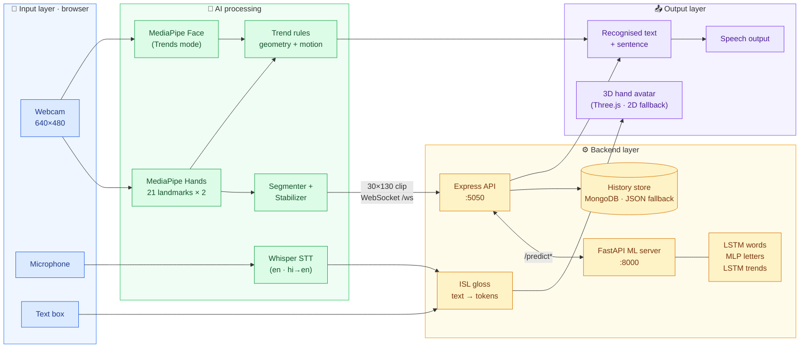
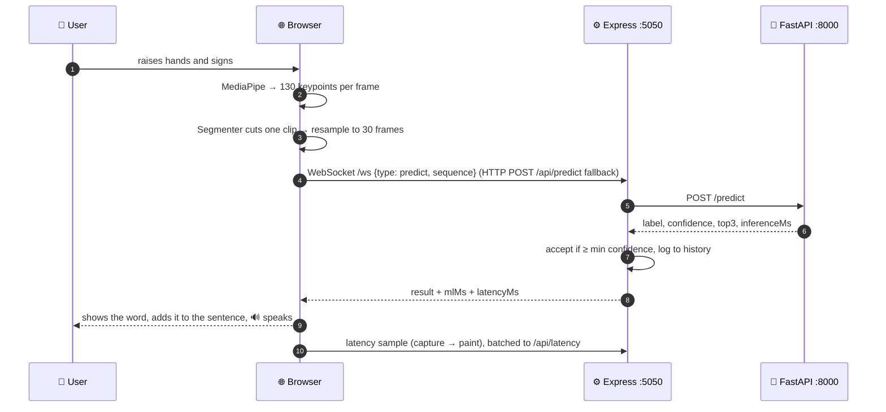
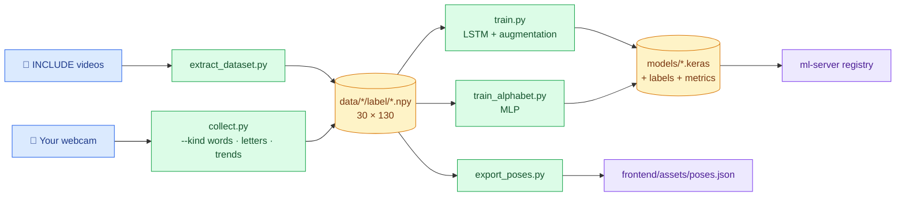

<div align="center">

# 🤟 SignBridge

### Real-time, bidirectional Indian Sign Language ⇄ speech translation in the browser

[](#-quick-start)
[](ml/train.py)
[](https://developers.google.com/mediapipe)
[](ml-server/app/main.py)
[](backend/src/app.js)
[](.github/workflows/ci.yml)

**B.Tech CSE Major Project 2023–27** · Ajay Kumar Garg Engineering College, Ghaziabad (AKTU)
Supervisor: **Dr. Sandeep Yadav**

</div>

---

## ✨ Features

| | Feature | How |
|---|---|---|
| 🖐️ | **Sign → Text (words)** | MediaPipe hand landmarks → motion-based clip segmentation → LSTM. **40 ISL signs, 88.5 % accuracy** (5-fold CV) |
| 🔤 | **Fingerspelling (A–Z)** | A per-frame classifier, stabilised over a short hold. **96.0 % ± 3.8 %** on held-out recordings |
| 🔥 | **Trends mode** *(new)* | Recognises social-media gestures: Clock it, 6-7, 🫶, 💪 muscle heart, 🫰, ✌️, 🤘, 🤙, 🤟, 👌, 👍, 👎 and L-on-forehead. Rules work today; a trained model takes over when one exists |
| 🔊 | **Text → Speech** | Builds a sentence from recognised signs and speaks it |
| 🎤 | **Speech / Text → Sign** | **Whisper** speech-to-text in any browser, English or **Hindi** (Hindi is translated to English) → ISL gloss (drops articles, matches multi-word signs) → sign or fingerspell tokens |
| 🗄️ | **History** | Every recognition is logged to **MongoDB** when `MONGO_URL` is set, or to a JSON file otherwise |
| 🎞️ | **Hand player** | Replays recorded keypoints as a 2D hand skeleton (the 3D avatar is on the roadmap) |
| 📈 | **Metrics** | Every training run saves accuracy / precision / recall / F1 to `ml/models/metrics_*.json` |

---

## 🏗️ Architecture



### Sign → Text, step by step



### ML pipeline



---

## 📁 Folder structure

```text
sign-language-translator/
├── 📄 README.md
├── 🐳 docker-compose.yml        # whole app: docker compose up --build
├── 📂 docs/
│   ├── ROADMAP.md               # done / left vs. the synopsis + execution plan
│   ├── DEPLOY.md                # Docker, Hugging Face Spaces + Render
│   ├── COMPARISON.md            # our results vs. published baselines
│   └── study/                   # usability study: protocol + SUS, results template, score.py
├── 📂 frontend/                 # static site, no build step
│   ├── index.html
│   ├── css/styles.css
│   ├── assets/poses.json        # recorded keypoints for the hand player
│   ├── js/
│   │   ├── main.js              # bootstrap: tabs, health, mode switch
│   │   ├── config.js            # API URL, thresholds, MediaPipe model URLs
│   │   ├── api.js               # backend client
│   │   ├── camera.js            # webcam + MediaPipe Hands / Face
│   │   ├── recognizer.js        # keypoints, Segmenter, Stabilizer (pure, tested)
│   │   ├── ui.js                # DOM helpers, sentence, history
│   │   ├── modes/               # words.js · letters.js · trends.js
│   │   ├── trends/              # rules.js (gesture logic) · catalog.js (emoji + how-to)
│   │   ├── text-to-sign.js      # text/speech → tokens → chips
│   │   ├── hand-player.js       # playback + 2D skeleton view
│   │   ├── avatar3d.js          # Three.js 3D hand avatar (drag to rotate)
│   │   ├── socket.js            # auto-reconnecting WebSocket, HTTP fallback in api.js
│   │   ├── latency.js · probe.js # end-to-end latency probe (p50 / p95)
│   │   └── speech.js            # mic → Whisper (Web Speech fallback) + text-to-speech
│   └── test/                    # node:test unit tests + Python parity fixture
├── 📂 backend/                  # Express API gateway
│   ├── src/
│   │   ├── server.js · app.js · config.js · ws.js (WebSocket channel)
│   │   ├── routes/              # predict.js · history.js · translate.js · transcribe.js · latency.js
│   │   └── services/            # mlClient.js · historyStore.js · mongoStore.js · gloss.js · latency.js
│   ├── test/                    # gloss, API (fake ML server), history stores
│   ├── Dockerfile               # API + WebSocket + web page on one port
│   └── .env.example
├── 📂 ml-server/                # FastAPI inference
│   ├── app/                     # main.py · registry.py · schemas.py · speech.py (Whisper)
│   ├── Dockerfile               # models + Whisper; also runs on Hugging Face Spaces
│   └── requirements.txt
├── 📂 ml/                       # data collection + training (run from ml/)
│   ├── signbridge/              # shared: keypoints · camera · augment · metrics · dataset · config
│   ├── signs.txt                # the 54-sign vocabulary (40 from INCLUDE, 14 to record)
│   ├── collect.py               # record words / letters / trends from webcam (--signer tags clips)
│   ├── train.py                 # LSTM for words or trends (--split random | signer)
│   ├── train_alphabet.py        # MLP for A–Z
│   ├── fetch_include.py         # download chosen INCLUDE words straight to .npy (no 57 GB download)
│   ├── extract_dataset.py       # INCLUDE videos already on disk → .npy
│   ├── video_to_npy.py          # single video → .npy
│   ├── export_poses.py          # → frontend/assets/poses.json
│   ├── live_test.py             # desktop live test, no servers needed
│   ├── models/                  # trained .keras + labels (committed)
│   └── requirements.txt
└── 📂 .github/workflows/ci.yml  # tests on every push
```

---

## 🚀 Quick start

**Easiest: Docker** (no Python or Node setup). Install Docker Desktop, then:

```bash
docker compose up --build        # first build ~5-10 min, then open http://localhost:5050
```

We demo it locally; putting it online is optional (Hugging Face Spaces + Render, see **[docs/DEPLOY.md](docs/DEPLOY.md)**). To run it without Docker, for development:


**Requirements:** Python **3.11** (MediaPipe 0.10.7 + TensorFlow 2.19; `brew install python@3.11` on macOS), Node **18+**, a webcam, and Chrome or Edge (needed for the mic).

<details open>
<summary><b>🍎 macOS / Linux</b></summary>

```bash
# 1 · Python env (once)
python3.11 -m venv .venv && source .venv/bin/activate
pip install -r ml/requirements.txt -r ml-server/requirements.txt

# 2 · Terminal A — ML server
cd ml-server && uvicorn app.main:app --port 8000

# 3 · Terminal B — backend
cd backend && npm install && npm start            # http://localhost:5050

# 4 · Terminal C — frontend
cd frontend && python3 -m http.server 8080        # open http://localhost:8080
```

> ℹ️ The backend uses port **5050** because macOS's AirPlay Receiver already listens on 5000.
>
> 🎤 **Whisper:** the first start downloads the `small` model (~460 MB) once, in the background. Until then, and in Chrome/Edge without the ML server, the mic falls back to the browser's own speech recognition.
>
> 🗄️ **MongoDB (optional):** `MONGO_URL=mongodb://127.0.0.1:27017/signbridge npm start` (local, Docker `docker run -p 27017:27017 mongo:7`, or a free Atlas URL). Without it, history goes to `backend/data/history.json`.
</details>

<details>
<summary><b>🪟 Windows (PowerShell)</b></summary>

```powershell
# 1 · Python env (once)
py -3.11 -m venv .venv ; .venv\Scripts\Activate.ps1
pip install -r ml\requirements.txt -r ml-server\requirements.txt

# 2 · Terminal A — ML server
cd ml-server ; uvicorn app.main:app --port 8000

# 3 · Terminal B — backend
cd backend ; npm install ; npm start

# 4 · Terminal C — frontend
cd frontend ; py -3.11 -m http.server 8080        # open http://localhost:8080
```
</details>

Both status dots in the header turn green once the backend and the model are reachable.

---

## 🕹️ Using it

| Mode | What to do |
|---|---|
| **Words** | Raise your hands, do **one** sign, then drop your hands or hold still. Recognition happens when the clip ends. |
| **Letters** | Hold a letter shape steady for about 1 s; it is added to the sentence. |
| **Trends** | Do a gesture from the table below and hold it. For 6-7, one or two up-down swaps is enough. Your face is detected (dashed box) for the face-relative gestures. |
| **Text / Speech → Sign** | Type or 🎤 speak a sentence, press **Translate**, then **▶ Play**. |

### 🔥 Trend gestures

| | Gesture | How | | Gesture | How |
|---|---|---|---|---|---|
| ⚖️ | **6-7** | Both open hands bounce up and down in turn | 👌 | **OK** | Thumb and index tips touch, other fingers up |
| 🫶 | **Heart hands** | Index tips touch on top, thumb tips below | 🫰 | **Saranghae** | Korean finger heart (사랑해): bent index with the thumb crossed over it, others folded |
| 🫵 | **L on forehead** | Thumb + index L held at the forehead | 👍 👎 | **Thumbs up / down** | Fist, thumb up or down |
| 👀 | **Clock it** | Straight index finger at your eye or temple, thumb tucked | 🤟 | **I love you** | Thumb, index and pinky out |
| 🤘 | **Rock on** | Index + pinky out, thumb folded | 🤙 | **Shaka** | Thumb + pinky out |
| ✌️ | **Peace** | Index and middle in a V | 💪 | **Muscle heart** | Flex one arm, its hand droops down; the other hand curls up to meet it, thumb at the bicep |

---

## 🧪 Training your own models

All commands run from `ml/` with the venv active.

### Word signs: vocabulary and signer-independent evaluation

The vocabulary lives in [`ml/signs.txt`](ml/signs.txt): **54 signs**.
- **40 come from INCLUDE** and are trained today: greetings, people and pronouns (I, you, we, mother, doctor…), describing words (good, bad, hot, sick…), hospital, school and time.
- **14 are not in INCLUDE** and must be recorded by the team: yes, no, please, sorry, what, where, name, again, help, pain, water, emergency, understand and stop.

```bash
python fetch_include.py --list               # every INCLUDE word (262) with its clip count
python fetch_include.py --signs signs.txt    # downloads only those videos (~13 MB each) -> keypoints, deletes the video
```

**Current model** (776 clips: 750 INCLUDE videos plus our own `idle` and `good_afternoon` clips):

| Evaluation | Result |
|---|---|
| **5-fold cross-validation, 40 signs + idle** | **88.5 % ± 3.2 %** (folds 85.2–94.2 %) ✅ target ≥ 85 % |
| Held-out test split of the deployed model | 87.2 % (top-3 99.4 %, macro F1 0.86) on 156 clips |
| Same pipeline with 22 signs / 15 signs | 90.6 % ± 3.9 % / 95.6 % ± 1.8 % |
| Weakest signs | good_afternoon (64 % recall), friend (75 %), you / happy / good_night (76 %): similar hand shapes, only 14–21 examples each |
| Tried: bidirectional LSTM | 88.3 % ± 3.0 %, no better, so not used |

Clips are split randomly, so the same INCLUDE signers appear in training and test data. **Team recordings fix both problems:** they add about 60 more examples per sign, and they make the signer-independent test possible. Details: `ml/models/metrics_words.json` and `ml/models/cv_words.json`.

**Every team member records with their own `--signer` name.** That way `train.py` can test on a person the model has never seen, which is the honest number for the report.

```bash
# 1 · each person, on their own laptop (~30-40 min for all 54 + idle, hands-free, resumable: re-run to continue)
python collect.py --signer tanishka --auto 15 --list signs.txt

# 2 · put everyone's ml/data/landmarks/<sign>/my_<name>_###.npy into one ml/data/landmarks/
#     INCLUDE clips:  python fetch_include.py --signs signs.txt

# 3 · evaluate on unseen signers -> models/metrics_words_signer.json (target >= 85 %)
python train.py --signs signs.txt --split signer               # auto-picks who to hold out
python train.py --signs signs.txt --split signer --holdout tushar

# 4 · train the deployed model on everyone -> models/sign_lstm.keras + metrics_words.json
python train.py --signs signs.txt
python export_poses.py                            # hand player gets the new signs (keeps existing ones)
```

Then restart the ML server; the frontend and text-to-sign pick up the new vocabulary automatically.

### Letters, trends, testing

```bash
# Fingerspelling
python collect.py --kind letters                  # A..Z, SPACE to record
python train_alphabet.py --cv                     # accuracy for the report: leave-one-recording-out
python train_alphabet.py                          # train + save the deployed model

# Trends (optional: rules already work without this)
python collect.py --kind trends --auto 20 clock_it six_seven heart_hands muscle_heart saranghae \
       peace rock_on shaka ily ok thumbs_up thumbs_down l_forehead idle
python train.py --kind trends                     # ml-server picks it up on restart

# Quick desktop test, no servers needed
python live_test.py --kind words                  # or letters / trends / raw
```

---

## 🔌 API

| Service | Method & route | Body → response |
|---|---|---|
| Backend | `GET /` | the web app itself (served from `frontend/`, so one URL works for page + API) |
| Backend | `GET /api/health` | → `{backend, ml, signs, letters, trendsModel}` |
| Backend | `POST /api/predict` | `{sequence: 30×130, minConfidence}` → `{label, confidence, top3, accepted, latencyMs}` |
| Backend | `POST /api/predict-letter` | `{keypoints: 130}` → same shape |
| Backend | `POST /api/predict-trend` | `{sequence: 30×130}` → same shape (404 until a trends model is trained) |
| Backend | `GET · POST · DELETE /api/history` | recent recognitions `{mode, label, confidence, at}` |
| Backend | `GET /api/signs` | word vocabulary |
| Backend | `POST /api/text-to-sign` | `{text}` → `{tokens: [{type: sign\|fingerspell, …}]}` |
| Backend | `POST /api/transcribe?language=en\|hi\|auto&task=transcribe\|translate` | raw audio body (`audio/*`) → `{text, language, latencyMs, …}` |
| Backend | `WS /ws` | `{id, type: "predict", kind: words\|letters\|trends, sequence\|keypoints}` → `{id, ok, label, confidence, top3, accepted, mlMs, latencyMs}`; `{type: "ping"}` → `pong` |
| Backend | `GET · POST · DELETE /api/latency` | browser posts one sample per prediction; GET → p50 / p95 / mean per stage (`?transport=ws\|http`, `?mode=`) |
| ML server | `GET /health`, `POST /predict`, `/predict-letter`, `/predict-trend` | raw model inference |
| ML server | `POST /transcribe` | multipart `audio`, `language`, `task` → Whisper result (503 if faster-whisper isn't installed) |

Backend settings go in environment variables (see [`backend/.env.example`](backend/.env.example)): `PORT`, `ML_URL`, `ML_TIMEOUT_MS`, `HISTORY_FILE`, `MONGO_URL`, `TRANSCRIBE_TIMEOUT_MS`. ML server: `WHISPER_MODEL` (`tiny`/`base`/`small`/`medium`, default `small`), `WHISPER_PRELOAD=0` to skip loading Whisper at startup. To point the frontend at another backend, set `window.SIGNBRIDGE_API` before loading `js/main.js`.

---

## ✅ Tests

```bash
cd backend && npm test      # 39 tests (+1 MongoDB test when MONGO_URL is set): gloss, API (fake ML server), recognizer, trend rules, Python↔JS parity
```

---

## ⏱️ Latency

Every prediction is timed in the browser from **camera capture of the frame that ended the sign → result painted on screen**, split into stages. Open *Tuning & debug* to see live p50 / p95, or pull the report:

```bash
curl localhost:5050/api/latency            # p50 / p95 / mean per stage, also split by transport
```

Measured on a MacBook (Apple Silicon, Chrome, all three servers local, WebSocket), 18 word predictions:

| Stage | p50 | p95 |
|---|---|---|
| MediaPipe hand detection (per frame, live camera) | 20 ms | 23 ms |
| Network browser ⇄ backend | 17 ms | 22 ms |
| Backend + ML server (LSTM inference ≈ 47 ms) | 51 ms | 77 ms |
| Paint | 22 ms | 27 ms |
| **Total, capture → text on screen** | **88 ms** | **120 ms** ✅ target ≤ 280 ms |

Not included: the segmenter's **end-of-sign wait** (≈ 0.3–0.5 s, reported as `endWaitMs`). This is how long the hands must drop or stay still before a clip counts as finished. It's a tuning choice (`Segmenter` `endAbsent` / `endStill`), not processing time.

---

## 🗺️ Project status

| Done ✅ | Next ⏳ |
|---|---|
| MediaPipe keypoints (Python ⇄ JS parity) | Record the 14 signs INCLUDE lacks |
| LSTM words (**40 signs, 88.5 % CV**) · MLP letters (96.0 %) · Trends mode | Signer-independent result ≥ 85 % |
| FastAPI registry · Express gateway · WebSocket | Run the usability study ([kit ready](docs/study/USABILITY_STUDY.md)) |
| Whisper STT (English + Hindi) · MongoDB | INCLUDE paper numbers in [comparison](docs/COMPARISON.md) |
| Three.js 3D avatar · latency p95 ≈ 90–120 ms | — |
| Signer-split eval · metrics JSON · 39 tests · CI · Docker (one-command run) | Paper + final report |

Full checklist and dated plan: **[docs/ROADMAP.md](docs/ROADMAP.md)**.

---

## 👥 Team

| Member | Role |
|---|---|
| Tushar Anand | Literature review, requirements, documentation |
| Tushar Nagpal | Sign recognition (computer vision + deep learning) |
| Tanisha Bhatt | Speech recognition, text processing, translation module |
| Tanishka Gautam | Frontend, system integration, testing, deployment, repository |

<div align="center">

**Supports** &nbsp;


<sub>Built on INCLUDE (Sridhar et al., 2020) · MediaPipe Hands (Zhang et al., 2020) · LSTM (Hochreiter & Schmidhuber, 1997)</sub>

</div>
